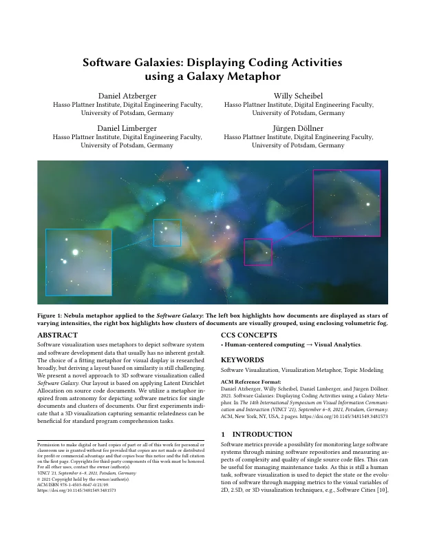
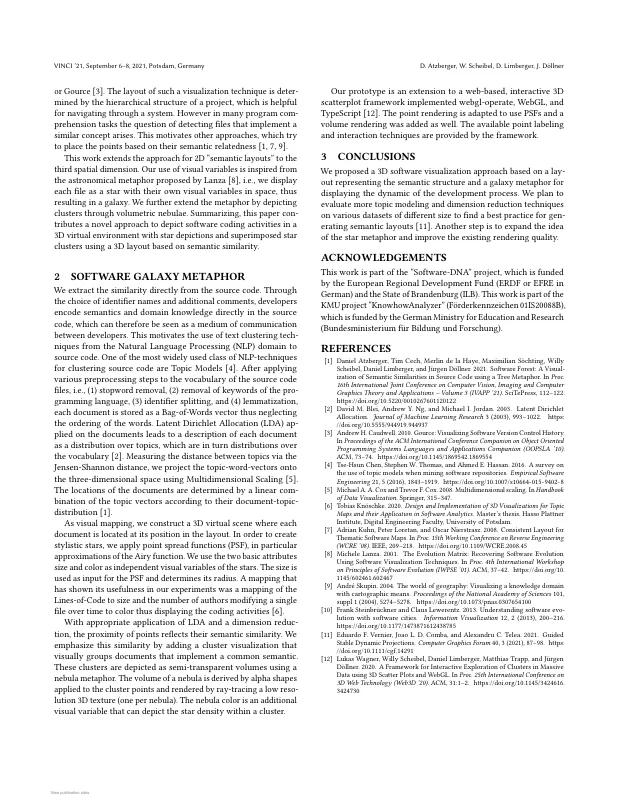

# Software Galaxies: Displaying Coding Activities using a Galaxy Metaphor

Daniel Atzberger, [Willy Scheibel](https://orcid.org/0000-0002-7885-9857), [Daniel Limberger](https://orcid.org/0000-0002-9111-4809), and [Jürgen Döllner](https://orcid.org/0000-0002-8981-8583)

*Proceedings of the 14th International Symposium on Visual Information Communication and Interaction (VINCI '21)*, September 6–8, 2021, Potsdam, Germany. ACM, pp. 24:1–2.

DOI: [10.1145/3481549.3481573](https://doi.org/10.1145/3481549.3481573) · [ResearchGate](https://www.researchgate.net/publication/354332172)

> Software visualization uses metaphors to depict software system and software development data that usually has no inherent gestalt.
> The choice of a fitting metaphor for visual display is researched broadly, but deriving a layout based on similarity is still challenging.
> We present a novel approach to 3D software visualization called *Software Galaxy*.
> Our layout is based on applying Latent Dirichlet Allocation on source code documents.
> We utilize a metaphor inspired from astronomy for depicting software metrics for single documents and clusters of documents.
> Our first experiments indicate that a 3D visualization capturing semantic relatedness can be beneficial for standard program comprehension tasks.

<p><a href="atzberger2021-software-galaxy-as-submitted.pdf"></a> <a href="atzberger2021-software-galaxy-as-submitted.pdf"></a></p>

## Contents

- [`src/`](src/) – LaTeX sources of the camera-ready version (ACM `acmart`, sigconf, 2-page poster paper)
- [`atzberger2021-software-galaxy-as-submitted.pdf`](atzberger2021-software-galaxy-as-submitted.pdf) – camera-ready PDF (author build of 2021-08-13)
- [`build.sh`](build.sh) – reproducible build with TeX Live 2019 (podman or docker)
- [`preview/`](preview/) – page previews for this README

## Build

```bash
./build.sh        # → build/article.software-galaxies.pdf
```

The paper was compiled in August 2021 with pdfTeX 1.40.20 (TeX Live 2019), hence the TeX Live 2019 container.
The build reproduces the camera-ready PDF with identical text, pages, columns, line counts and figure placement; only the line breaks inside the generated "ACM Reference Format" block on page 1 differ slightly.
The sources come from the Overleaf project; six author names in `references.bib` were restored to their full form as printed in the camera-ready PDF (the Overleaf state had initials).

## Versions

- [`v1.0-camera-ready`](https://github.com/dl-archive/article.2021-vinci-software-galaxy/tree/v1.0-camera-ready) – sources as submitted to ACM (2021-08-13)

## Citation

```bibtex
@InProceedings{atzberger2021-software-galaxy,
  author    = {Atzberger, Daniel and Scheibel, Willy and Limberger, Daniel and D{\"o}llner, J{\"u}rgen},
  title     = {Software Galaxies: Displaying Coding Activities using a Galaxy Metaphor},
  booktitle = {Proceedings of the 14th International Symposium on Visual Information Communication and Interaction},
  year      = {2021},
  series    = {VINCI~'21},
  publisher = {ACM},
  pages     = {24:1--2},
  doi       = {10.1145/3481549.3481573},
  isbn      = {978-1-450386-47-0},
}
```
